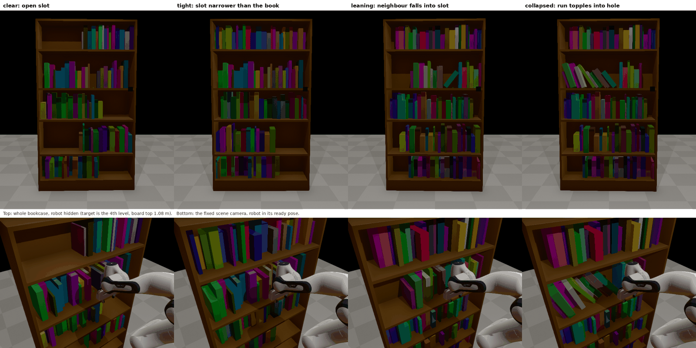

# MuJoCo bookshelf, ported from ContactExplorer

`shelf_scene.py` builds the bookshelf scene for the gap-creation project in MuJoCo.
It starts from the shelf in ContactExplorer's singulation task
(`src/tasks/allegro_singulation.py`, Isaac Gym Preview 4) and turns it into a full,
randomized bookcase standing on the floor. It also adds a Franka Panda with thin
10 mm fingers, a wrist camera and a force/torque sensor.



## The bookcase

The bookcase is built from the floor up:

```
  top board
  ┌──────────────────┐
  │ level 4  (filler)│   ← books welded in place (static) by default
  ├──────────────────┤
  │ level 3  (TARGET)│   ← free books, scenario row, robot works here
  ├──────────────────┤
  │ level 2  (filler)│
  ├──────────────────┤
  │ ...              │
  ├──────────────────┤   ← board_0
  └──plinth──────────┘   floor
```

- **3 to 5 levels**, each 0.25 to 0.40 m tall, on a 5 to 10 cm plinth. Side panels and the back panel run from the floor to the top board.
- **One target level** is chosen per episode, from the levels whose board top is 0.40 to 1.10 m off the floor (within the Panda's reach).
  It holds the scenario row: clear, tight, leaning, collapsed or packed.
- **Books line up at the front**, as on a library shelf: each spine sits 10 to 30 mm behind the shelf's front edge,
  and every book is at least 30 mm shallower than the shelf, so no back goes past the back panel (the deepest
  book, set furthest in, just touches it).
- **Every other level** holds an ordinary upright row, 50 to 100% full, packed against a random side panel.
  These books are **static** by default (no joint), so they add almost no simulation cost. Set
  `ShelfConfig(static_other_levels=False)` to make them free, e.g. to check in evaluation that nothing gets knocked off.
- **The robot base follows the target level**, like a lift: base height = target board top − 0.40 m,
  0.80 m in front of the shelf. The arm then always sees the same geometry relative to the row it works on,
  and can hold its hand level to slide a book in. (The Panda can only point its hand level with the hand
  about 0.5 m or more above its base, because joint 6 bends one way only.)

## What was taken from the repo, and what changed

| Isaac Gym repo | MuJoCo version | Why it changed |
| --- | --- | --- |
| `_define_table`, `_define_upper_shelf`: one board 0.5 m up, one above | `board_0` … `board_N`, stacked from a plinth on the floor, plus `top_board` | A real bookcase, with books above and below the target row |
| `_define_back_wall`, `_define_side_wall`: walls for one cubby | `back_panel` and side panels from floor to top | Same parts, full height |
| Shelf 0.344 × 0.26 m, fixed | 0.6 to 1.0 m wide, 0.22 to 0.32 m deep, randomized levels and pose | Room for 12 to 20 books per row and space to push them |
| 5 boxes, 4 × 16 × 24 cm, fixed size | Every book a different, random size, mass and friction | Real shelves are mixed |
| Neighbour boxes have `fix_base_link=True` and friction `1e-5` | Target-row books are **free bodies** with normal friction (0.25 to 0.7) | Your task is to push neighbours, so they must be movable |
| PhysX `friction`, `restitution` | MuJoCo `friction`, `solref`, `solimp`, `condim=4` | Different contact model |
| Two fixed cameras, 640×480, 58° | `scene_cam` (fixed, off to the side, aimed at the target row) + `wrist_cam` on the Panda hand | Robot blocked the front view; wrist camera sees the gap up close |
| xArm6 + Allegro hand | Franka Panda from MuJoCo Menagerie, with thin 10 mm fingers, + F/T sensor at the flange | Your chosen robot; Menagerie's 21 mm fingers don't fit the narrower tight gaps |

`python shelf_scene.py --repo-defaults` rebuilds the original single cubby (board top at 0.51 m) and box size, for comparison.

## Implementation steps

1. **Install**
   ```bash
   git clone --recurse-submodules <this repo>     # or, in an existing clone:
   git submodule update --init                     # fetches mujoco_menagerie
   uv sync                                         # installs mujoco and numpy from pyproject.toml
   ```

2. **Generate scenes**
   ```bash
   uv run python shelf_scene.py --seed 0 --panda mujoco_menagerie/franka_emika_panda/panda.xml --out scenes
   ```
   This writes one `.xml` (the MuJoCo scene) and one `.json` (levels, book sizes, target slot, gap edges) per scenario,
   then settles each scene and prints whether it is stable. `scenes/` is git-ignored: the XML holds absolute paths.

3. **Look at a scene**
   ```bash
   uv run python view_scene.py --scenario leaning --seed 0       # add --no-robot for the bookcase only
   ```
   This settles the row first, so leaning and collapsed books show slanted, then opens the viewer.
   (Opening an XML directly with `python -m mujoco.viewer --mjcf ...` shows the start state, with every book upright.)
   Either way the camera starts on the gap, from the front and to one side, so the robot isn't in the way.
   The scene sets this as MuJoCo's default free camera (`<statistic>` and `<visual><global>`), so you can still
   orbit, and the viewer's Align button brings you back to it. MuJoCo's viewer only applies it by itself when it
   opens a file, so `view_scene.py` and `insert_book.py --view` apply it themselves.

4. **How the target row is made (the key idea)**
   Books are placed upright, then the leaning and collapsed scenarios push some of them over during a short
   settling phase. This way every lean is a real resting pose found by physics, not a hand-set angle that
   might overlap other books.
   - Leaning: the gap is sized from the lean angle you want (12° to 35°), so the book comes to rest against its neighbour.
   - Collapsed: a run of 3 to 6 books topples into a hole next to it. The hole is sized the same way, so the run
     leans far enough to stay down and lands on the book across the hole below its top.
   - In both, the spare row space goes to the end away from the toppling. The books that catch the lean are
     packed against a side panel and can't slide away.
   - Packed: no gap at all. The slot's neighbours stand upright, face to face (no spacing between them either), so
     the only room is the row's spare space: 3 to 15 cm at one end, plus 0 to 3 mm between books. In 97% of rows
     that is enough on one side for the book plus 6 mm (all of them, using both sides).

5. **Use it in your training code**
   ```python
   import numpy as np
   from shelf_scene import ShelfConfig, make_episode
   cfg = ShelfConfig()
   rng = np.random.default_rng(0)
   model, data, row, report = make_episode(cfg, "collapsed", rng,
                                           panda_xml="mujoco_menagerie/franka_emika_panda/panda.xml")
   start_qpos = data.qpos.copy()      # settled state = the episode's start
   print(row.target_level, row.target_board_top)
   ```
   `make_episode` throws away the occasional row that keeps sliding and samples again.
   For RL, generate a few thousand settled `qpos` vectors once and reset from that list. Settling inside every
   reset is too slow.

   `qpos` layout: 9 robot values (7 arm + 2 fingers), then 7 per target-row book (position + quaternion),
   then 7 per filler book only if `static_other_levels=False`.

6. **Scripted insertion (clear, tight, leaning and packed scenarios)**
   ```bash
   uv run python insert_book.py --scenario clear --seed 0                # one episode: prints each step and the score
   uv run python insert_book.py --scenario tight --seed 0 --trials 50    # success rate over seeds 0 to 49
   uv run mjpython insert_book.py --scenario tight --seed 0 --view       # watch it (the macOS viewer needs mjpython)
   uv run mjpython insert_book.py --scenario leaning --seed 12 --view    # a leaner it has to clamp
   uv run mjpython insert_book.py --scenario packed --seed 7 --view      # a packed row it manages
   ```
   One controller for every scenario (`Episode.reshelve`): it looks at the slot, takes the high-level step the
   slot needs next, and looks again. The scenario only picks the row.

   | The slot | Step |
   | --- | --- |
   | a neighbour leans into it (more than 5°) | `stand_up`: lift it upright, or clamp it if the fingers can't get under it |
   | narrower than the book plus 6 mm (at the spines; at its narrowest after a shove or a stand-up, which can leave a neighbour turned), and the fingers (stacked, 10 mm) fit in it where they go | `widen`: push a neighbour aside with them |
   | narrower, and they don't (the neighbours touch) | `shove`: pinch a neighbour, shove it and the books beyond into the row's free space |
   | wide enough, or nothing more would widen it and the book fits | `insert` |

   Each step starts from wherever the arm is and leaves the hand out of the shelf, so the steps follow one another
   in any order, and one that falls short is simply taken again: a second stand-up; a second widening, on the
   other side if it has the room; a third on the first side with the arm configured for force, while the book
   still doesn't fit. A clear row comes out as `insert`, a tight one `widen, insert`, a leaning one
   `stand_up, insert`, a packed one `shove, insert` or `shove, widen, insert`. These are the high-level steps a
   policy could choose between; `push_back`, `walk_out`, a single pinch (`shove_stage`), `lift_up`, `clamp_up` and
   `fingertip_push` are the smaller moves they are built from.

   Seeds 0 to 199 of each scenario, ground truth:

   | | clear | tight | leaning | packed | all four |
   | --- | --- | --- | --- | --- | --- |
   | per-scenario scripts (`0ff9d92`) | 199 | 185 | 195 | 183 | 762 |
   | one controller | 200 | 197 | 199 | 184 | 780 |
   | in place after, s, on rows both place | 10.5 → 11.0 | 18.9 → 21.6 | 22.0 → 22.9 | 90.1 → 87.9 | |
   | actions (moves and waits), same rows | 10 → 10 | 17.6 → 19.8 | 17.0 → 17.5 | 69.1 → 68.3 | |

   Clear's time now includes the 0.5 s the gripper takes to close at the start. Tight rows take 2.7 s longer: a
   second widening is a step of its own (the fingers come out and go in again), and wedged books slow down near
   the neighbour's face. The most-moved other book moves as much as before (tight 9.1 mm on average, leaning 3.3,
   packed 64).

   What changed, besides the shared controller:
   - Retries come free: a leaner that fell back gets a second stand-up (leaning 142: 5.3° after the clamp); a
     widening that fell short gets the other side, then the first side again with the arm configured for force
     (`choose_strong`), which pushes heavy runs the arm gave way to (tight 92, 119, 125: the first push moved
     the neighbour only a few mm, and the old top-up could only go on from the arm configuration it was in).
   - Every row is inserted along the middle of the straight way in, or, if that is narrower than the book plus
     3 mm, wedged past the swivelled or turned neighbour (`wedge_slot`), as packed rows already were. Tight rows
     that jammed at the entrance now mostly go in. The wedge slows down 15 mm before the face it will meet:
     sliding on at full speed and wedging only once the book stopped lost 6 tight rows (it hits the face and
     jams). Its slow part runs at 4 cm/s (was 2): the same tight rows go in, 4 s sooner. Aiming the tight
     widening at the narrowest gap instead of the spines placed 199 but took 47 s a book: the fingertips swivel
     the neighbour, so the back never opens and nearly every row was widened three times.
   - Rows the old scripts didn't expect: a clear row (167) and a tight one (also 167) where a thin neighbour
     tipped into the gap as the row settled get stood up; a tight row with a gap narrower than the fingers (160)
     gets shoved; a leaning row whose other neighbour leans away (86), so the gap is 10 mm at the board but 45 mm
     where the fingers go, gets widened (the widening now measures the gap at the fingers' height).
   - Fixes in shared code: carrying on into the next step planned and ran with the arm's posture from before the
     move to its start (after a lift, 1.6 rad off on the wrist), and the IK's pull drove the arm toward a
     singularity mid-slide, which the wrist felt as a jam (leaning 93). It now plans the move to the start with
     the old posture and the step with the one it starts in, and runs them so. The clamp closed at the gripper's
     own speed and squeezed the 56 mm book out of the grasp (leaning 117); it now closes at 5 cm/s like the
     shove's pinch. If neither hand turn for the final push stays clear of the joint limits, the arm changes
     configuration for it instead of giving up (leaning 136). Choosing a configuration for force counts the
     moment of the pushed books' resistance 6 cm behind the fingers, so the arm yields less and turns the book
     less (on the 11 packed rows whose neighbour turned, 5 placed against 3 without it, none lost).
   - Heavy runs are split when they turn: the first shove of a run of 5 books or more stops as soon as the
     neighbour has turned 15° (the camera sees it), and the run is shoved in two, its far half first. Before, the
     split came only after the whole first shove, by when the neighbour had turned 20 to 40° and the gap was shut
     at the back. The stop fires in 11 of the 200 packed rows: 38 and 176 now go in, 96 doesn't (184 against
     183), at the same time per book. How much a run turns does grow with its load (the books' weight times
     their friction): 5° on average under 30 N, 25° at 75 to 90 N. But splitting by load up front, into
     segments of at most 35 or 50 N shoved farthest first (with the true masses), cut the turning in the worst
     rows (38: 40° to 9°) and still placed only 2 or 3 of the 11 turned-run failures, lost a row that worked,
     and took heavy rows that one or two pinches did before 5 or 6 (up to 3 times as long): each segment ends
     a little short, and the next can only go as far as the gap ahead. Stopping at 4° fired in 160 rows (most
     runs turn that much early and go in anyway) and placed 181. 4 of the 11 failures weren't heavy at all
     (33 to 44 N).
   - Removed: the packed stagger (10 and 5 of 100 placed) and `--strategy split` (34 of 49 against one side's 47).
   - Tried and dropped: the widening aimed at the spines after a shove too (packed 175: the book then goes in
     without the widening the turned neighbour needs); levelling only the books on the side pushed (packed 180:
     pushing the shoved neighbour back is what lets the fingers reach the other one in some rows, though in
     packed 128 it shuts the gap); taking the force configuration nearest the arm's (0.7 s faster per packed
     book); the slide's reach from the fingers' real opening instead of fully open (5 of 40 clear rows then had
     no arm configuration); shoving the side with too little room for the book just far enough for the fingers
     (no row gained).

   Left, of seeds 0 to 199:
   - Packed, 16. Five neighbours can't be pinched even to walk them out (3, 79, 152, 156, 166): the books beside
     them stand at the back panel, or a light neighbour goes back with them when they are pushed, and the other
     side has less room than the fingers need; in 111, pushing its 16 mm flanks back drags the neighbour 30 mm
     back with them. These need a second contact (a second arm or a suction cup, see below). The other 10 are
     runs whose neighbour turns in the shove (96, 119, 122, 123, 125, 128, 132, 165, 173, 195): the arm yields,
     with joint 6 at its 12 N m and joint 1 at its 87 N m, and the hand turns with the book; afterwards the
     wedge jams or the gap stays short. Which of these rows go in flips from run to run: the per-scenario script
     placed 4 of them (128, 165, 173, 195), and lost 5 others that now go in (47, 92, 94, 176, 178).
   - Tight, 3 (51, 132, 181), and leaning, 1 (139, where the lift swivelled the leaner 42° about the vertical, out
     of the shelf in front of the slot): books that jam at the entrance or stop short. The per-scenario script
     placed 132 and 139 and lost 51 and 181. Correcting the insertion as it goes is what the residual policy is for.

   **Insert**: a hand-written baseline. The target book is held in the gripper at a pre-insertion pose in front of the gap.
   The robot rests the book's back on the board's edge and slides it in while holding it. It lets go before its
   fingers reach the neighbours' spines (each finger is wider than the clearance beside the book), turns its hand
   90°, and pushes the spine low down with the lower fingertip until the book is in place (no push if the slide
   already got it there). A book going in tightly drags its neighbours back, so it measures where the book has to
   go again after the slide, and pushes again if the push dragged them further. It scores the result as the proposal does: upright within 5°, in place, released, plus
   how far the other books moved. In place means:
   - spine within 10 mm of the spine of the neighbour that sticks out more, or
   - if the book is deeper than that neighbour, so it can't line up without its back passing the back panel:
     at least 10 mm behind the shelf's front edge. With the default rows that's rare (about 1 row in 400: a book
     near the maximum depth beside neighbours set more than 25 mm in, as the inserted book stops 5 mm short of
     the back panel), but it also covers other layouts such as `--repo-defaults`.
   - Control: Menagerie's position actuators, fed by differential IK along min-jerk paths, with gravity compensation.
     The arm configuration is chosen so the whole sequence stays clear of the joint limits and doesn't run into
     the shelf. The slide and the final push stop when the wrist force sensor feels the book stop giving way.
   - The script adds the target book to the scene, and gives the gripper the real Franka Hand's 70 N (Menagerie's
     squeezes a book with 1 to 2 N). It only changes its own copy of the model.
   - The fingers pinch the book 11.5 cm above its bottom. Higher up, board friction tips the book over the pads
     while it slides.
   - The fingers are thin bars in place of Menagerie's (`shelf_scene.py`, `make_panda_with_sensors`): 10 mm wide
     across their travel, 12 mm thick, as long as Menagerie's, with a pad strip along all 46 mm of each finger
     that reaches past the palm. The real Franka Hand takes custom fingers, so these could be machined.
   - The book is held right up against the palm (its spine 2 mm off it), so the whole pad strip grips it. Held
     3 cm off the board for 3 s, books then turn 3.1° in the hand on average (5.1° for the 8 that weigh over
     1.2 kg), against 4.7° (7.8°) with the spine 8 mm out and a 35 mm pad. Insertion results are the same. A short
     pad is worse: with a 19 mm one, the board's drag turned a book 6° in the grasp on one clear row (seed 9) and
     it fell over.
   - The fingers start 0.2 mm off the book when they close on it, inside its 0.5 mm contact margin. Right on
     the margin, one pad's contact could start a step late, and that finger ended up 9 mm inside the book (on
     leaning seed 5, which then flew off when let go).
   - Clear, seeds 0 to 99: all 100 succeed, in place after 10 s on average. No episode moved another book more
     than 0.25 mm.

   **Widen** (tight rows): the gap is first widened to the book's thickness plus 6 mm at the spines. Measured
   with the per-scenario script unless it says otherwise.
   - Fingertip: the empty hand puts its fingers (stacked vertically, 10 mm wide) into the gap and pushes a
     neighbour aside. It pushes the side with room for all of the widening (the one with more free space if
     both have), as far as the widening needs or that side's space allows. If the gap at the spines is then
     still short of the book plus 6 mm, the next widening pushes the other side, by what is missing. Then the
     book is handed over (not modelled) and inserted as above. Used when the fingers fit the gap and reach at least
     1 cm past a neighbour's spine (the 63 mm palm stops 46 mm behind the fingertips, at the most protruding spine
     nearby). There is no force limit: the arm pushes as hard as it can (joint 6 reaches its 12 N m at 55 to
     100 N, depending on the pose).
   - Skipped otherwise, or when the push leaves the gap at the spines narrower than the book: no insertion,
     counted as a failure. The fingers need 12 mm (1 mm clear each side) and the generator's tight gaps are at
     least 12.2 mm, so none are skipped for that. With Menagerie's 21 mm fingers, 10 of the 50 rows below were
     (gaps of 12 to 23 mm), and these other ways to widen them were tried and dropped:
     - Pushed sideways at its back corner, the held book turns in the grasp: 2° at 9 to 15 N, 3 to 19° at 20 N,
       and at 40 N up to 31°, much of it for good. Sliding the books takes more than that. A 140 N grip barely helps.
     - A book wedge (held turned, back corner first, then straightened) was tried and dropped. Its slanted face
       pushed the neighbour back into the shelf instead of aside (31 mm back and 2.5 mm aside on seed 21). It
       placed none of its 18 rows, and dragged neighbours up to 12 cm into the shelf.
   - Seeds 0 to 49, default `one-sided`: 48 succeed (one needed no widening), in place after 19 s on average. The
     fingertip handles the other 49 rows and places 47. Every push left the gap at least as wide as the book. The
     2 that fail (seeds 16 and 31) end up 4 to 5 cm proud of the neighbour. With Menagerie's 21 mm fingers, 37
     succeeded.
   - In 14 fingertip rows the first push left the gap short, so the other side was pushed too (13 of them placed).
   - Earlier changes, measured with Menagerie's 21 mm fingers:
     - Dropping the old 35 N limit on the books' estimated friction gave the fingertip 8 rows that used to go to
       the wedge (3 of them now placed), and let 6 rows that had to split push one side instead (4 of them failed
       before and now succeed). Seed 27 now pushes the side the estimate put at 93 N, and succeeds. Nothing that
       worked before fails.
     - Measuring where the book has to go again after the slide, and pushing again when the push drags the
       neighbours back, placed 2 more (seeds 0 and 46, which had stopped 12 to 15 mm proud of the neighbour) and
       4 more with `split`. Rows that already worked take 0.1 s longer on average.
   - One side versus splitting, on the same 49 fingertip rows: one side places more, 47 vs 34 (35/50 overall
     with the split, which has been removed). Splitting swivels both neighbours, so the book's back corners
     catch on both sides and it jams at the entrance more often. In 9 rows it leaves the gap narrower than the book, so they are skipped.
     Where both worked, the most-moved book moved about the same (6.2 vs 5.6 mm, one side
     vs split) and one side was 1.6 s faster (18.3 vs 19.9 s). Splitting needs much less force, as fewer books
     must slide at once.
   - Books have room behind them, so a book sliding in tightly can also drag its neighbours back. On seed 0 it
     drags the pushed neighbour 82 mm back, and still counts as placed: success only checks the inserted book.
   - Why it's hard: the fingertips push a neighbour only near its spine, so it swivels instead of sliding. The gap
     opens at the spines but barely at the back, and the book has to widen the rest as it slides in. That is the
     contact-rich part the proposal's residual policy is meant to learn.

   **Stand up** (leaning rows): a neighbour leans into the slot (more than 5°), so it is stood back up first.
   Then the row is handled as a tight one: widened if the gap is short, then the insertion.
   - Lift: the closed fingers, stacked so they take 10 mm along the row, go under the leaning book as far up its
     face as they fit, and lift it along an arc about the bottom corner it pivots on. They press square on its
     face, so it turns rather than slides. They stop just short of upright, within its tipping angle
     (atan(thickness / height)) and still leaning slightly into the slot, so it stands up the rest of the way by
     itself instead of going over onto its other side. Up to 3 lifts, each closer to upright.
   - Clamp, when the fingers can't get under it at any height: they pinch it across its thickness near the spine,
     with the hand rolled to its lean, and swing it about its bottom edge to just short of upright. Only one
     finger has to fit between it and the far book. The other goes between it and the book on its own side,
     which gets pushed along a little.
   - A thin book let go in a gap more than twice its thickness can lean over, so it goes 3 mm off the taller
     upright neighbour instead of in the middle.
   - Seeds 0 to 49: every leaner is stood up, 47 by the lift and 3 by the clamp (seeds 12, 26 and 37), and all
     50 books are placed, in place after 21.9 s on average. 45 rows need no widening after the stand-up and 5 are
     widened with the fingertip. Leaving out the book that was stood up, the most-moved book moves 3.1 mm on
     average (median 0.3 mm, worst 41 mm on seed 26, where the clamp pushes the leaner's own side along).
   - The lift's fingers come in up to 4 mm off the leaning book's face, and as much lower, as far as the room
     beside them allows. When the room was only checked where they press on the book, they passed within
     0.1 mm of the far neighbour on seed 5 and dragged it 4 cm into the shelf. In 6 rows the most-moved book
     then moved 27 to 44 mm, against 0 to 10 mm now.
   - The rod on `feat/leaning-controller` (8 cm past the fingertips, pushing the leaner sideways at the top of
     the wedge under it) stands up 46 of these 50 and doesn't insert. By its test right after the stand-up
     (leaner under 8°, no other book tilted 10° or more, gap at least the book plus 4 mm without widening), 45
     pass here. The other 5 just need the widening that follows. The same fingers stand the book up,
     widen the gap and insert it, with no tool change.

   **Shove** (packed rows): the neighbours touch, so room has to be made first, and it can only come from the
   row's free space at one end: every book between the slot and that space has to slide along.
   - Shove:
     1. The fingers, stacked and 1 mm apart, push the books in front of which the fingers will go (the other
        neighbour, and the book past the neighbour on the side with more free space) straight back, until their
        spines are 35 mm behind that neighbour's. If they can't go back 12 mm, the other side is tried. (Fully
        closed, the fingers press on each other with all the gripper's force, and a knock pushed one pad into the
        other, where they stuck.) If neither can, or what is left to pinch is too little, the neighbour is
        walked out of the row (`walk_out`): the books beside it go back as far as they can, the fingers pinch
        what little of it sticks out, their tips 1.5 mm in front of those books (it only pulls, so the arm
        doesn't sag in), pull it 10 mm out, and pinch again deeper, until it is 35 mm out. Pinches of 2 mm
        held it. It goes back to where it stood once shoved.
     2. That neighbour now sticks out of the row. The fingers go either side of it, 4 mm off its faces, with the
        hand turned to its yaw, the fingertips 7 mm in front of the books pushed back (down to 4 mm if they could go
        back less than 19 mm) and the palm 12 mm in front of the other books: under the load the arm sags 6 to 10 mm
        deeper, and a fingertip on a spine pins that book by friction, a palm drags it along. They close on it
        at 5 cm/s. At the simulated gripper's own speed (over 2 m/s from a few mm away) the pads went 18 mm into
        the book before their contact stopped them, and squeezed it 3 cm back into the shelf.
     3. They shove it, and every book beyond it, away from the slot until the gap is the book plus 6 mm at its
        narrowest over the depth the book will take up. The whole run slides, which takes 30 to 110 N (the
        books' weight times their friction, 52 N in the median row). Along the row the arm pushes with 55 N
        (joint 6 at its 12 N m) to 130 N depending on its configuration, so the configuration is chosen for
        force (`choose_strong`). The strong ones have joint 5 near its limit, so they keep 0.02 rad from the
        joint limits instead of 0.05, and they reach it 1.5 to 2 cm into the push.
     4. If the gap is still short, the arm lets go and pinches again, up to 5 times, each with the
        configuration chosen afresh: the hand level or pointing 15° or 30° down into the shelf (which moves the
        load off joint 5), and pushing only 15 mm if that is much stronger. Before each, the books the fingers
        will be in front of go back, as the run has turned and fanned out.
     5. The neighbour still turns, 6° in the median row: the run pushes back far behind where the fingers hold
        it, and a 70 N pinch resists about 5 N m of turning (with 140 N it turned nearly as much). Where the run
        takes more than about 60 N, the neighbour pivots on its back corner rather than sliding the run, and
        pushing harder only turns it more.
        So if the gap is still short and the run has 5 books or more, the far half of the run is shoved on its
        own (pinching the book halfway along), then the near half into the gap that leaves. The first shove of
        such a run stops as soon as the neighbour has turned 15°, so the split comes before the gap shuts at the
        back.
     6. The arm holds where it got to (it lags behind its target under the load), lets go, eases the fingers off
        the book's faces (else they drag it out with them), takes them out, and pushes the book back in line,
        square to its spine. Then the book goes in as in a clear row, along the middle of the straight way in
        (a turned neighbour narrows it and moves its middle off the gap's at the spines) if that clears the
        book by 3 mm.
     7. Otherwise the neighbour has turned: its front went with the fingers and its back stayed, so the gap is
        wide at the spines and shut at the back. The fingers can't open it: they reach only about 4 cm behind
        the spines, and pushing a spine turns the book further. The tight-row widening first pushes the other
        neighbour into the room on its side, aiming at the narrowest gap. That neighbour went back for the
        shove, and the palm has to stay in front of the books it sweeps past, so the books there that stand
        proud of it (the shoved neighbour among them) first go back level with it: else the fingertips reach
        only its front. In rows where the side shoved has barely room for the book, the run's turned books
        take up more of it than when upright, and the room on the other side is needed too. Then the book
        itself opens the rest (`wedge_slot`): held, it slides in where its back corners meet a neighbour's
        face deepest (along the straighter neighbour's face if only one turned, between the two if both did),
        as usual until 15 mm before that, then at 2 cm/s, stopping only above 60 N (at 90 N it slipped back
        in the fingers). Its back corner meets the turned face deep in the shelf, near the middle of the
        books' friction, and pushes it aside, so the neighbour and the run beyond straighten. Let go, the book
        is pushed home until the wrist feels 100 N (at 40 N, wedged books stayed 3 to 9 cm out). If the
        fingertips can't reach a neighbour, or no arm configuration does the widening, the book is wedged in
        straight away.
     8. If neither side alone has room for the book, one side is shoved as far as its room allows, and the
        widening takes the rest from the other.
   - Results, seeds 0 to 199 (ground truth, the Panda with the thin fingers):

     | | seeds 0 to 99 | seeds 100 to 199 |
     | --- | --- | --- |
     | stagger | 10 | 5 |
     | first shove (one pinch, level; commit `eb33682`) | 69 | 60 |
     | shove, finished with the tight-row widening | 82 | 72 |
     | shove, finished with the widening and the wedge | 90 | 78 |
     | ... the books beside the other neighbour levelled first | 92 | 80 |
     | ... the widening planned with the books it pushes moving | 94 | 81 |
     | ... and the neighbour walked out where it can't be pinched | 96 | 89 |

     The staged pinches and the split were made looking at seeds 0 to 99; on seeds 100 to 199 they place 15
     rows the first shove didn't and lose 3 (paired exact test, p = 0.008). The wedge was made looking at the
     turned-neighbour failures of both halves, so seeds 100 to 199 are no longer a fresh test for it: it
     places 14 rows more and loses none; levelling the books beside the other neighbour, 5 more, losing 1;
     planning the widening with the books it pushes moving, 3 more; walking the neighbour out, 10 more,
     losing none. The most-moved book moves 65 mm on
     average, and a book is in place after about 88 s (the first shove: 45 s, the stagger: 25 s): the arm
     changes configuration for each pinch and push.
   - Of the 15 rows lost, 6 have a neighbour that can't be pinched even to walk it out: in 5 it stands level
     with or behind the books beside it once they are back, and in 1 a book further along stands so far out
     that the palm can't come close enough. The other 9 follow a turned neighbour: 4 jam at the entrance, 3
     are left narrower than the book even at the spines, and 2 wedged books stay 3 to 9 cm out.
   - Fixes made on the way, outside the packed code:
     - `reposition` keeps the arm's posture while it takes the hand out of the shelf. Choosing the next
       configuration had already set the IK's rest posture to it, and its pull swung the arm round mid-move
       (2.9 rad off in 30 steps), into the shelf. Clear, tight and stagger trials are unchanged.
     - A joint move that can't go direct or by way of the tucked home pose tries random waypoints, and
       `choose_arm` tries 3 more rounds of starts if the first 3 found nothing.
     - The tight-row widening plans the fingers free to touch every book on a side they push, not only the
     neighbour: those go ahead of the fingers, but not in the planner's static scene, where a push longer
     than the neighbour is thick ran the fingers into the next book (the same as `push_back` ignoring the
     book it pushes). Tight rows are unchanged (48 of seeds 0 to 49).
   - `face_x` takes a book's face from its own axes. It took the two corners furthest along the row, which
       are the back face's once the book has turned more than atan(thickness / depth), about 7°.
   - Tried and dropped: shoving long runs in two from the start (they lose rows a single shove manages);
     turning the hand against the book's turn; pulling the book out and taking it again with the whole pad
     (43 mm instead of 28); a 140 N grip; grippier pads; moving the robot base; turning the neighbour further
     before the wedge, so the book meets it deeper (the run's fronts have used up the row's free space by
     then: 0 to 13 mm were left); planning the hand around turned books' outlines rather than their bounding
     boxes (no change); shoving heavy runs in segments of 3 books, the farthest first (they pivot as well:
     one row more, two fewer); squeezing the wedged book at 140 N to slide it harder, or pushing it home
     with up to 150 N (no change); widening again, both sides, when the first widening falls short (no
     change); dragging a tall neighbour out by its top under a low board (it tips 6 to 7° until its top
     meets the board, then the fingers slip over it).
   - Tilting the neighbour out by its top (fingers pressing just behind its spine and pulling) works: its top
     comes out with the hand, 5 cm at 16°, its bottom staying put. But let go, it falls back upright, and a
     parallel gripper can't hold it tilted and pinch it at once. Rocking it (pushing its spine high up, then
     letting it fall) only walks it back into the shelf. So rows where the books beside the neighbour have no
     room behind them need another way to pull it out, such as a suction cup or a second arm.
   - A second Panda (a study, not in this code), on a base it places beside or above the first, as a mobile
     arm would, and out of reach until it is needed (parked beside the first, its tucked arm blocked the
     first's moves). Where the neighbour can't be walked out (it stands level with or behind the books
     beside it), the first arm puts its open fingers where the neighbour's top will come out, the second
     presses its closed fingers on the top just behind the spine and tips the neighbour forward about its
     front bottom edge (up to 20°, less under a low board above: its top back corner rises), the first
     closes on it, the second leaves, and the first pulls it 35 mm out while standing it up. And where the
     wedged book stalls with its middle still out of the shelf, the second arm pinches its top from above,
     outside the shelf, and both push it in. Seeds 0 to 199: 190 (one arm: 185): it places the 5 rows
     that can't be walked out and one stalled wedge, and 3 rows flip either way between the runs. Before the walk-out, the second arm placed 11 of the 20 rows
     one arm couldn't pinch; on the 5 with a tall neighbour under a low board, a search over 8 pinches of the
     first and 24 bases of the second (192 pairs per row) found none that both arms can do, but walking
     the neighbour out places 3 of them with one arm. Pinching the neighbour with both arms, one above the
     other, to shove harder gained nothing (-6 to +0.1 mm): a turned run's back doesn't follow pushes at
     its front however hard.
   - What would help, measured with hardware changes that aren't in this code (on an earlier version of the
     shove that placed 67 of seeds 0 to 99): a suction cup on a plunger between the fingers, to pull the
     neighbour out where the books beside it can't go back, 77; wrist joints as strong as a KUKA iiwa's (40 N m
     instead of 12), 73; both, 83. On the current sequence (168 of seeds 0 to 199): the suction cup (60 kPa,
     4 cm past the fingertips, pulling the neighbour 35 mm out where one arm can't pinch it), 182: 14 of the
     20 rows one arm can't pinch, 3 more than a second arm, losing none, but it loses its hold on two thin
     books (on a 16 mm spine it holds only 8 to 9 N); the gripper at the Franka Hand's 140 N peak throughout,
     169. Of the 18 rows the cup leaves, 16 are runs whose neighbour turns and 2 are those thin books.
   - A stagger was tried first and removed (10 and 5 of seeds 0 to 99 and 100 to 199): the closed fingers pushed
     one neighbour 2 cm back so the other's side showed in front of it, and pushed that one aside from there.
     Pushed at its front corner, it swivelled, came partly out of the shelf and took up more of the row. An
     earlier study found the same with other moves: dragging a book's top or spine by friction slides the books
     rather than tipping them, while a sideways push at the top tips the run 12° at 6 to 58 N and it mostly
     stays tipped, leaving a V to wedge into.
   - `free_space` counts each side's room as its length less the books' thicknesses, not from the books'
     outlines: a pushed book that turned would otherwise seem to fill the row, and the widening would pick the
     wrong side. For upright books (clear and tight rows) both give the same.

7. **Next pieces to build on top** (from the design doc)
   - Swap the Panda's position actuators for torque (`motor`) actuators and write the impedance controller.
   - Spawn the target book in the gripper for other code too (`insert_book.py` does it for its own runs;
     `build_scene` still leaves `row.target_book` out).
   - Add the gap-creation moves and insertion on top of that controller (`insert_book.py` scripts them with
     position control, as a baseline).
   - Replace the black fiducial plate with an AprilTag texture, and add spine textures for perception.
   - For GPU training, load the same XML in MJX or MuJoCo Warp and check it still settles the same way.

## Perception (`perception.py`)

What the robot knows about the target row, limited to what a wrist RGB-D camera could report. Code that decides
what to do (the RL policy, and ideally the scripted sequences) should read a `ShelfEstimate` rather than `data`,
so a camera-based source can replace the ground truth later without changing it.

```python
from perception import GroundTruthPerception, NoisyPerception
est = GroundTruthPerception(model, row).estimate(data)       # or NoisyPerception(GroundTruthPerception(...), rng)
est.book(-1).lean, est.book(+1).spine_y                      # the slot's left and right neighbours
est.min_gap_width(0.25)                                      # narrowest free width up to 25 cm above the board
```

- **Each book is its spine face**: four corners in the shelf frame, and the values derived from them (thickness,
  height, lean, swivel, how far out the spine sits). `slot_offset` names it relative to the slot: -1 and +1 are
  the neighbours.
- **The gap** is the free width at the spine plane at 8 heights above the board (1 to 29 cm), between everything
  left and right of the slot, side panels included. A leaning neighbour shows as a gap that narrows with height.
- **Not measured**: a book's depth is a prior (17 cm, capped to fit the shelf), since the camera only sees spines.
  Mass, friction, contact forces and velocities are left out; they are for the reward and critic only.
- `NoisyPerception` adds 2 mm of noise to each corner and reads gaps under 4 mm as closed. These are starting
  guesses for a wrist camera.
- Note: `row.gap_right - row.gap_left` is up to 3 mm short of the actual face-to-face gap, because `gap_left`
  is set after the left neighbour's spacing. Measure the gap from the books, as `perception.py` does.

Tests: `uv run pytest`.

## Settings (`ShelfConfig`)

| Setting | Default | Meaning |
| --- | --- | --- |
| `num_levels` | 3 to 5 | Shelf boards above the plinth |
| `level_height` | 0.25 to 0.40 m | Clear height of each level |
| `plinth_height` | 0.05 to 0.10 m | Bottom kick board |
| `target_band` | 0.40 to 1.10 m | Allowed height of the target board's top surface |
| `fill_other_levels` | 50 to 100% | How full the non-target rows are |
| `static_other_levels` | `True` | Weld non-target books in place, for speed |
| `spine_inset` | 10 to 30 mm | How far each spine sits behind the shelf's front edge |
| `depth_clearance` | 30 mm | Every book is at least this much shallower than the shelf |
| `robot_xy`, `robot_z_offset` | (0, 0.80), −0.40 m | Robot base position; its height follows the target board |
| `lean_angle_deg` | 12° to 35° | Lean for leaning and collapsed rows (raised when a book needs more to stay down) |

## Tested (MuJoCo 3.15.0)

| Scenario | Stable on first try | Notes |
| --- | --- | --- |
| clear | 40/40 | Nothing moves (< 0.2 mm) |
| tight | 40/40 | Nothing moves (< 0.2 mm) |
| leaning | 132/140 | Leans of 14° to 56°; failures are re-sampled by `make_episode` |
| collapsed | 136/140 | Runs lean 15° to 49°; failures re-sampled |
| packed | 40/40 | Nothing moves (≤ 0.2 mm); the slot's neighbours end up at most 1.1 mm apart |
| all four, free filler books | 60/60 | Stable with the other levels' books free too |

- Bookcases came out 0.96 to 1.99 m tall, with the target on levels 1 to 3 and its board top between 0.40 and 1.10 m.
- The robot touched nothing at the start in 360/360 scenes.

Run with the Python package, with the books front-aligned (seeds 0 to 39, or 0 to 139 for leaning and collapsed,
and 0 to 14 per scenario with free filler books).

## Things to know

- **Robot start pose.** The scene starts the Panda in a tucked "ready" pose (hand about 25 cm in front of the shelf).
  Menagerie's own "home" pose reaches 0.55 m forward. It knocked books over when the base stood 0.62 m out,
  and clears the shelf at 0.80 m.
- **Robot height.** On a high target level the robot stands on a tall pedestal (up to about 0.7 m), and on the
  lowest one (board top 0.40 m) it stands on the floor. That models a lift or mobile base. To use a fixed base
  instead, narrow `target_band` and set `robot_z_offset` accordingly. Don't lower `target_band` below 0.40 m
  without raising the base, or it ends up below the floor.
- **Topple threshold.** Some settled books lean more than 45°. When scoring "no neighbour toppled", measure each
  book's tilt *change* from its settled pose, not its absolute tilt.
- **Two leaning neighbours** (one on each side of the gap) are not generated: pushing both at once made one fall
  flat. Use the collapsed scenario for several leaning books.
- **Generated robot file.** `shelf_scene.py` writes `panda_shelf.xml` (Menagerie's Panda with the thin fingers,
  wrist camera and F/T sensor) into `mujoco_menagerie/franka_emika_panda/` so the robot's mesh paths still work.
  The submodule is set to ignore untracked files, so this doesn't show as a change.
- **Shelf width.** If you set the shelf very narrow, `sample_row` raises an error when fewer than 4 books fit.
