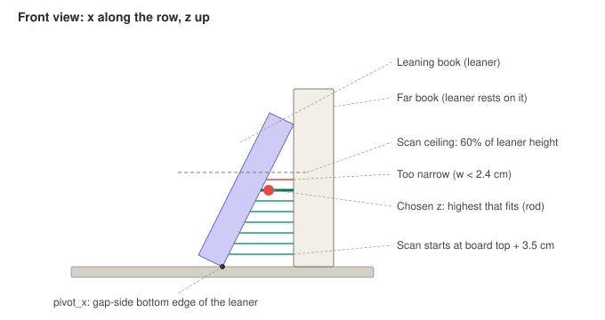
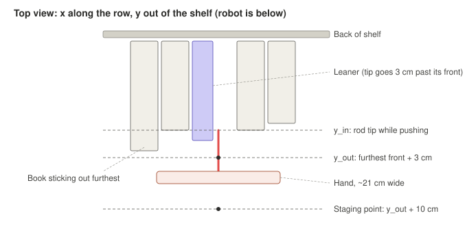

# Leaning-book controller: how `scripted_controller.py` plans and executes the push

This document explains, step by step, how the scripted baseline for the **leaning** scenario stands a
leaning book back upright so the slot for the new book opens again. It covers how the controller picks the
contact point inside the wedge, how deep the tool goes, how the robot approaches and inserts, and what it
does afterwards.

Everything is expressed in the **shelf frame**: x runs along the row of books, y points out of the shelf
(toward the robot), z points up. `ShelfFrame.to_shelf()` / `to_world()` convert between this frame and
MuJoCo's world frame.

## Quick start: set up the leaning scene and run the controller

Run these from the repo root (`bila/`).

**1. One-time setup**

```bash
git submodule update --init          # fetches mujoco_menagerie (the Panda model)
uv sync                              # installs mujoco and numpy from pyproject.toml
```

**2. Generate a leaning scene and look at it** (books settled, before the robot moves)

```bash
uv run python shelf_scene.py --scenario leaning --seed 0 \
    --panda mujoco_menagerie/franka_emika_panda/panda.xml --out scenes   # writes scenes/*.xml + *.json, prints stability
uv run python view_scene.py --scenario leaning --seed 0                  # opens the viewer on the settled row
uv run python view_scene.py --scenario leaning --seed 0 --no-robot       # bookcase only
```

`view_scene.py` prints which book leans and by how much (e.g. `book_6 leans 31 deg`). In the viewer,
Rendering > Camera > `scene_cam` shows the whole target row. Opening a scene XML directly with
`python -m mujoco.viewer --mjcf ...` shows the start state with every book upright, because the lean only
appears after `settle()` runs.

**3. Run the controller on that scene, without the viewer**

```bash
uv run python scripted_controller.py --seed 0
# seed   0  OK    gap  12.0 ->  31.5 mm (need 23.0)  leaner tilt 24.3 -> 0.9 deg  others: ...
```

(The numbers above only show the format; yours depend on the seed.) The same `--seed` gives the same
shelf in `view_scene.py`, `shelf_scene.py` and `scripted_controller.py`.

**4. Watch the robot push the leaning book upright**

```bash
uv run mjpython scripted_controller.py --seed 0 --view
```

The viewer opens on `scene_cam`; the red rod is the pusher tool. The window stays open after the episode
ends; close it to get the printed result.

**5. Try other rows and evaluate in batch**

```bash
uv run python scripted_controller.py --seeds 20                        # seeds 0..19, prints success rate
uv run mjpython scripted_controller.py --seed 3 --view                 # watch any seed from the batch
uv run mjpython scripted_controller.py --seed 0 --tool-length 0 --view # bare fingers, no rod
uv run python scripted_controller.py --seeds 20 --spin-limit 30        # allow more yaw in the sliding push
```

Seeds that print `ERROR` (no wedge, or pose out of reach) are known gaps; pick another seed to watch.
`--seeds` never opens the viewer.

**6. Print the planned contact point and waypoints** — see [section 8](#8-printing-the-plan-for-a-seed).

### macOS troubleshooting

- Anything with `--view` must run under `mjpython` (the passive viewer needs the main thread).
  `view_scene.py` uses the blocking viewer, so plain `python` is fine there.
- `otool ... returned non-zero exit status 69`: accept the Xcode licence with
  `sudo xcodebuild -license accept` (or install the tools with `xcode-select --install`).
- `Library not loaded: @rpath/libpython3.12.dylib`: `mjpython` loads uv's Python into its own app
  bundle, where that Python's relative library path no longer resolves. Either point the loader at it:

  ```bash
  DYLD_LIBRARY_PATH="$HOME/.local/share/uv/python/cpython-3.12.12-macos-aarch64-none/lib" \
    uv run mjpython scripted_controller.py --seed 0 --view
  ```

  or link the library into the venv once
  (`ln -s ~/.local/share/uv/python/cpython-3.12.12-macos-aarch64-none/lib/libpython3.12.dylib .venv/libpython3.12.dylib`),
  or rebuild the venv on Homebrew's Python
  (`uv venv --python "$(brew --prefix python@3.12)/bin/python3.12" && uv sync`).

---

## Overview

The controller runs in two stages:

1. **Planning (once, in `ScriptedLeaningController.__init__`)** — read the book poses, find the wedge
   under the leaning book, choose a contact height, work out how deep the tool can go, and check with IK
   that the robot can reach the staging and pre-approach poses. Nothing moves yet.
2. **Execution (every physics tick, in `step()`)** — a small state machine that follows straight
   Cartesian lines between the planned points, pushes with a force-limiting "leash", and stops on
   closed-loop conditions (leaner tilt, slot width).

| Section in the code | What it does |
| --- | --- |
| 1. `make_leaning_episode` | Builds a leaning row, adds the pusher rod to the hand, settles the books |
| 2. Geometry helpers | Book corners, face planes, slot width, all in the shelf frame |
| 3. `TaskSpaceIK` | Damped least-squares IK used for planning and for tracking every tick |
| 4. `plan_unlean` | Chooses the contact point, push limit and tool depths (`LeanPlan`) |
| 5. `ScriptedLeaningController` | Reachability check, then the phase state machine |
| 6. `run_episode` / `main` | Runs an episode and scores it |

---

## 1. Building the scene

`make_leaning_episode()`:

- `sample_row(cfg, "leaning", rng)` creates a random bookcase. One book next to the target slot is
  "nudged" during settling, so it tips over and comes to rest against the book across the slot.
- The scene XML is loaded with `mujoco.MjSpec`, and an **8 cm pusher rod** (a capsule of radius 6 mm,
  red) is attached to `panda/hand`, starting at the fingertips (`FINGERTIP = 0.1034` m from the hand
  origin). Books sit up to ~15 cm behind the front of the board, and the Panda hand is ~21 cm wide, so
  without the rod the hand would have to enter the shelf and hit the neighbours.
- `settle()` runs physics until the books come to rest. The row is accepted only if no book drifts more
  than 2 mm and none tilts more than 60°; otherwise a new row is sampled (up to 10 tries).

## 2. Finding the leaning book (perception)

`plan_unlean()` currently takes the answer from the scene generator:

```python
nd = row.nudges[0]                 # the generator's record of which book it tipped over
leaner = row.books[nd["book"]]
lean_dir = +1 if (force in shelf frame).x > 0 else -1   # which way its top moved
far = the book on the other side of the target slot     # the one the leaner rests on
```

`lean_dir = +1` means the leaner's top moved toward +x, into the slot. All book *poses* are then read
directly from `MjData` (`geom_xpos`, `geom_xmat`). This is **privileged state**; a deployable version
would replace it with perception (wrist camera, spine labels / fiducials).

## 3. Choosing the contact height in the wedge



The leaner and the far book form a **wedge**: wide at the bottom, closing where the leaner's top touches
the far book. The controller looks for the **highest height at which the rod still fits** in it.

**Required width.** The rod is 12 mm in diameter, plus 6 mm of clearance on each side:

```python
need = 2 * contact_half + 0.012       # 2 × 6 mm + 12 mm = 24 mm
```

**The scan.** Walk up the wedge in 4 mm steps and measure its width at each height:

```python
for z in np.arange(z0 + 0.035, z0 + 0.6 * (top_z - z0), 0.004):
    xl = face_x_at(model, data, leaner.name, frame, lean_dir, z)   # leaner's slot-side face
    xf = face_x_at(model, data, far.name,    frame, -lean_dir, z)  # far book's face toward the leaner
    w  = (xf - xl) * lean_dir                                       # wedge width at this height
    if w >= need:
        best = (z, xl, w)
```

- `z0` is the top of the target board; `top_z` is the leaner's highest corner.
- The scan starts **3.5 cm above the board** and stops at **60 % of the leaner's height**.
- The loop never breaks early, so `best` ends up holding the **last (highest) height that fits**.
  Because the wedge narrows upward, the result is set by whichever limit comes first:
  the width dropping below 24 mm (typical for shallow leans of ~12°) or the 60 % ceiling (typical for
  steep leans).
- Multiplying by `lean_dir` makes `w` positive whichever side the leaner is on.
- If no height fits, `NoWedge` is raised: the leaner lies (almost) flat against the far book and there is
  nothing to push from.

**Why the highest point?** The book pivots about its bottom edge. A push applied higher gives more torque
about that pivot, so less force is needed and the bottom is less likely to slide. The 60 % ceiling keeps
the contact away from the closing tip of the wedge, where the rod could jam or slip off the top.

### How `face_x_at` finds a face's x at height z

A book is a box, so each side face is a plane.

1. The book's thickness axis in the shelf frame is `R[:, 0]` (with `R = frame.R.T @ geom_xmat`).
   Flip it if necessary so it points `toward` the requested side. This is the face's outward normal `n`.
2. The centre of that face is `pc = centre + n * half_thickness`.
3. Every point `p` on the plane satisfies `n · (p − pc) = 0`. Assuming the book is not rotated about the
   vertical (`n_y ≈ 0`), solve for x:

```
x = pc_x − n_z · (z − pc_z) / n_x
```

For an upright book `n_z = 0`, so the face has the same x at every height. For a leaning book
`n_z ≠ 0`, so x shifts with z — which is exactly what makes the wedge close toward the top.

### Where the rod goes, and how far it may push

```python
x_tool  = xl + lean_dir * (contact_half + 0.004)   # rod centre: one radius + 4 mm off the leaner's face
pivot_x = slot-side x of the leaner's bottom edge  # where its slot-side face will be once upright
x_limit = pivot_x + lean_dir * contact_half - lean_dir * 0.01
```

`x_limit` is a hard stop: the tool's setpoint is never pushed past the point where the leaner would be
upright plus 1 cm. In practice the closed-loop tilt check (below 1.5°) stops the push first.

## 4. Deciding how deep the tool goes



The scan fixed x and z. Now y: how far into the shelf the rod tip goes. The rod is short and the hand
behind it is wide, so the limit is usually the **hand**, not the rod.

```python
front   = lambda b: book_corners(model, data, b.name, frame)[:, 1].max()   # y of a book's front face
near    = [b for b in row.books
           if abs(b.x - x_tool) < HAND_HALF_WIDTH + b.thickness / 2 + 0.03]  # books under the hand
y_out   = max(front(b) for b in near) + standoff          # pre-approach: in front of all of them
hand_ok = max(front(b) for b in near) + 0.01 - tip_to_hand # deepest tip y with the hand 1 cm clear
y_in    = max(front(leaner) - 0.03, hand_ok)              # 3 cm past the leaner's spine, if the hand allows
y_deep  = max(front(leaner) - leaner.depth / 2, hand_ok)  # near mid-depth, for the sliding-push retry
```

- `tip_to_hand = (tool_length + 0.045) * cos(15°)` ≈ 12 cm: the rod plus the finger length, projected
  onto y because the tool is pitched 15° down.
- y gets smaller going into the shelf, so `max(...)` picks the **shallower** of the two candidates; the
  hand-clearance limit always wins.
- `standoff` is 3 cm (retried with 1.5 cm if the robot can't reach, see below).
- If the hand limit leaves less than 8 mm of rod on the leaner's spine
  (`y_in > front(leaner) - 0.008`), the push wouldn't hold, so planning fails with `NoWedge`.

All of this is returned as a `LeanPlan`:
`leaner, lean_dir, z, x_entry, x_limit, y_out, y_in, y_deep, wedge_at_z`.

## 5. Tool orientation and reachability

**Orientation.** For the whole task the tool points into the shelf (−y), pitched 15° down, with the
fingers spread along the row (x). It is built in `__init__` as `self.quat`. Pointing straight in this
close to the robot base is awkward for the Panda; the 15° pitch makes every slot reachable.

**Waypoints.** All three share the same x (`x_entry`):

| Point | Shelf-frame position | Purpose |
| --- | --- | --- |
| `stage` | `(x_entry, y_out + 0.10, z + 0.02)` | 10 cm out from the books and 2 cm higher: safe place to swing in |
| `target` | `(x_entry, y_out, z)` | Lined up with the wedge, just in front of the books |
| insert | `(x_entry, y_in, z)` | Same x and z, only deeper: the rod slides straight into the wedge |

**Reachability check before moving.** `TaskSpaceIK.solve_global()` solves IK for `stage` and then for
`target` (starting from the `stage` solution). It tries the current configuration first and then up to
19 random perturbations of it (300 IK iterations each), and keeps the best. A pose is accepted only if
the position error is under 5 mm and the tool axis is within 0.1 rad. If either fails, planning is
repeated with a 1.5 cm standoff; if that fails too, it raises `pre-approach pose out of reach`.

### The IK solver

`TaskSpaceIK.solve()` is damped least squares on a scratch `MjData` (so it never disturbs the
simulation):

```
err = [ p_target − p_tcp ,  W · rotation_error ]
dq  = Jᵀ (J Jᵀ + λ² I)⁻¹ err        λ = 0.01, step capped at 0.1 rad
q   = clip(q + dq, joint limits)
```

- The TCP is the rod tip: the hand origin plus `FINGERTIP + tool_length` along the hand's z axis.
- `W` down-weights rotation about the tool axis (roll weight 0.1): the rod is round, so roll hardly
  matters, and freeing it makes far poses reachable.

## 6. Execution: the phase state machine (`step()`)

Every physics tick, `step()` updates a Cartesian **setpoint**, converts it to joint targets, and writes
them to the Panda's position actuators (`data.ctrl[:7]`, gripper closed). Gravity and Coriolis forces on
the arm are cancelled by writing `qfrc_bias` into `qfrc_applied`, like the real Franka does internally.

Motion helpers:

- `_goto(target, speed)` moves the setpoint along a straight line toward `target` by `speed × dt` per
  tick and returns `True` on arrival.
- `_track()` turns the setpoint into joint targets with 3 IK iterations, warm-started from the previous
  tick's targets.
- `_push(direction, speed)` advances the setpoint along x, but never more than the **leash**
  (1.5 cm) ahead of the actual rod tip. If the books resist, the setpoint waits for the rod instead of
  running away, which caps the contact force.

| Phase | What happens | Ends when |
| --- | --- | --- |
| `to_stage` | Joint-space smoothstep from the tucked home pose to `q_stage` over 2.5 s (a large swing; a straight Cartesian line from the tucked pose could pass near singular poses) | 2.5 s + 0.5 s hold |
| `approach` | Straight line `stage → target` at 10 cm/s | arrival |
| `insert` | Straight line `target → (x_entry, y_in, z)` at 10 cm/s; only y changes | arrival |
| `unlean` | `_push` away from the slot (−`lean_dir`) at 3 cm/s | leaner tilt < 1.5°, or setpoint reaches `x_limit` |
| `settle` | Hold for 0.3 s, then measure the slot | — |

Pushing stops as soon as the leaner is upright and no further: the books behind it are not packed and
would topple like dominoes.

**If the slot is still too narrow** (narrower than the new book + 8 mm clearance, with 2 mm tolerance),
the controller widens it by sliding the now-upright book and the books behind it into the spare row
space:

| Phase | What happens | Ends when |
| --- | --- | --- |
| `lower` | Move to 5 cm above the board (`z_low`), 3 mm eased off the book | arrival |
| `deepen` | Move to the push depth (`y_in` first time) | arrival |
| `widen` | `_push` away from the slot at 2 cm/s; slot width checked at 20 Hz | slot ≥ need + clearance ("wide enough"), 10 cm of travel ("max travel"), or the book yaws > 20° ("book started to spin") |
| `settle2` | Hold for 0.3 s | — |

If the book spins before the slot is wide enough, the controller retries **once** at `y_deep`
(near the book's mid-depth), which spins it less but brings the wide hand closer to the neighbours.

**Letting go:**

| Phase | What happens |
| --- | --- |
| `backoff` | Move 6 mm back toward the slot to release the contact |
| `retract` | Pull straight out to `y_out` |
| `done` | Hold the last joint targets; the episode runs 1 s more to let things settle |

## 7. Scoring (`run_episode`)

An episode is a **success** when all of these hold:

- the controller reached `done`;
- the slot, measured over the new book's height, is at least the book's thickness + 4 mm;
- the leaner ends within 8° of upright;
- no other book's tilt changed by 10° or more.

The printed line also reports the slot width before and after, the leaner's tilt before and after, the
most any other book tilted or moved, whether the robot touched anything during the approach, and why the
widening push stopped. Rows with no wedge, or with poses out of reach, are reported as `ERROR` and count
as failures.

## 8. Printing the plan for a seed

Save as `print_plan.py` and run `uv run python print_plan.py`. It builds the same scene as
`scripted_controller.py --seed 0` and prints the planned numbers (shelf frame, centimetres).

```python
import numpy as np
from shelf_scene import ShelfConfig
import scripted_controller as sc

seed = 0
model, data, row = sc.make_leaning_episode(ShelfConfig(), np.random.default_rng(seed),
                                           sc.DEFAULT_PANDA, tool_length=0.08)
ctl = sc.ScriptedLeaningController(model, data, row, tool_length=0.08)
p = ctl.plan
cm = lambda v: np.round(100 * np.asarray(v), 1)
print(f"leaner {p.leaner}, lean_dir {p.lean_dir:+d}, tilt {ctl.leaner_tilt(data):.1f} deg")
print(f"contact z  = {100*(p.z - row.target_board_top):.1f} cm above board, wedge there {1000*p.wedge_at_z:.0f} mm")
print(f"x_entry {100*p.x_entry:.1f} cm, x_limit {100*p.x_limit:.1f} cm")
print(f"y_out {100*p.y_out:.1f}, y_in {100*p.y_in:.1f}, y_deep {100*p.y_deep:.1f} cm")
print("stage  (cm):", cm(ctl.stage))
print("target (cm):", cm(ctl.target))
print("insert (cm):", cm([p.x_entry, p.y_in, p.z]))
```

## 9. Known gaps and hooks for residual PPO

- **Privileged state.** Which book leans comes from `row.nudges`, and all poses come from `MjData`.
  Replace with perception for a deployable controller.
- **No wedge.** When the leaner lies flat against the far book (`NoWedge`), this controller has no move.
  A different primitive is needed, e.g. pressing on or hooking the leaner's top edge.
- **Very steep leans** (≈ 60°) tend to roll over instead of rising.
- **Sliding pushes** on books with free space behind them can spin the book rather than slide it.
- **Residual hook.** `step()` computes `self.setpoint` every tick before `_track()`. A residual policy can
  add its correction to the setpoint (and/or the push speeds) at that point and let `_track()` turn it
  into joint targets. Observations can start from what the controller already computes: book poses, slot
  width, leaner tilt and yaw, plus the wrist force/torque sensor.
